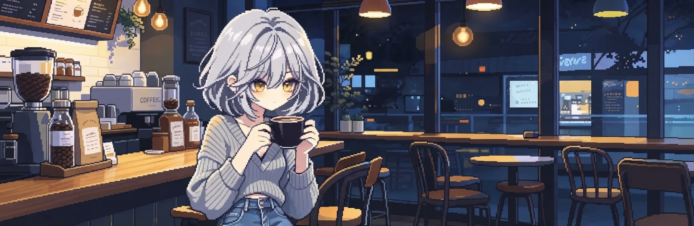
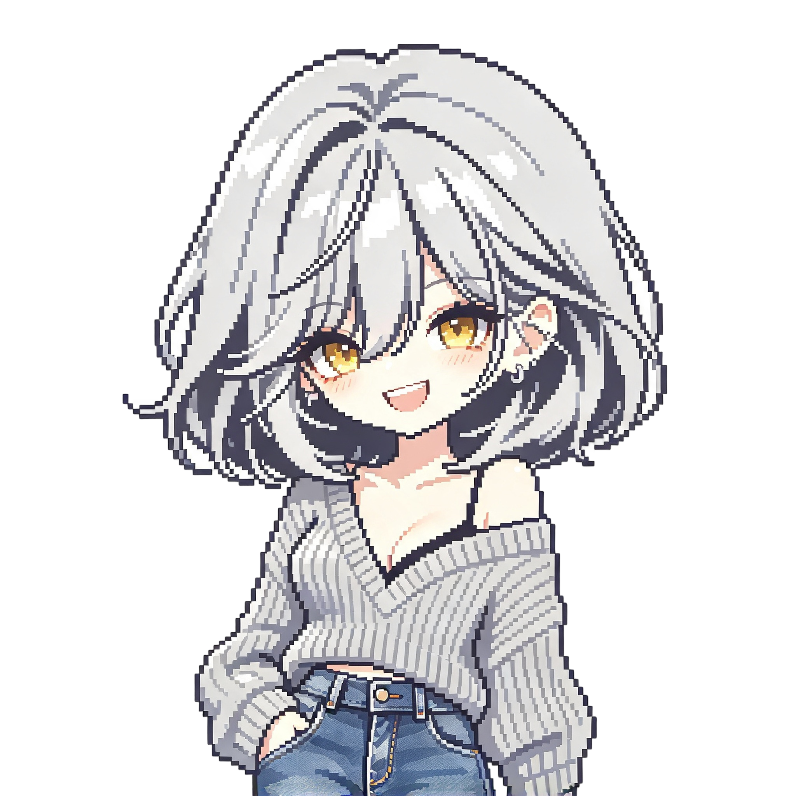
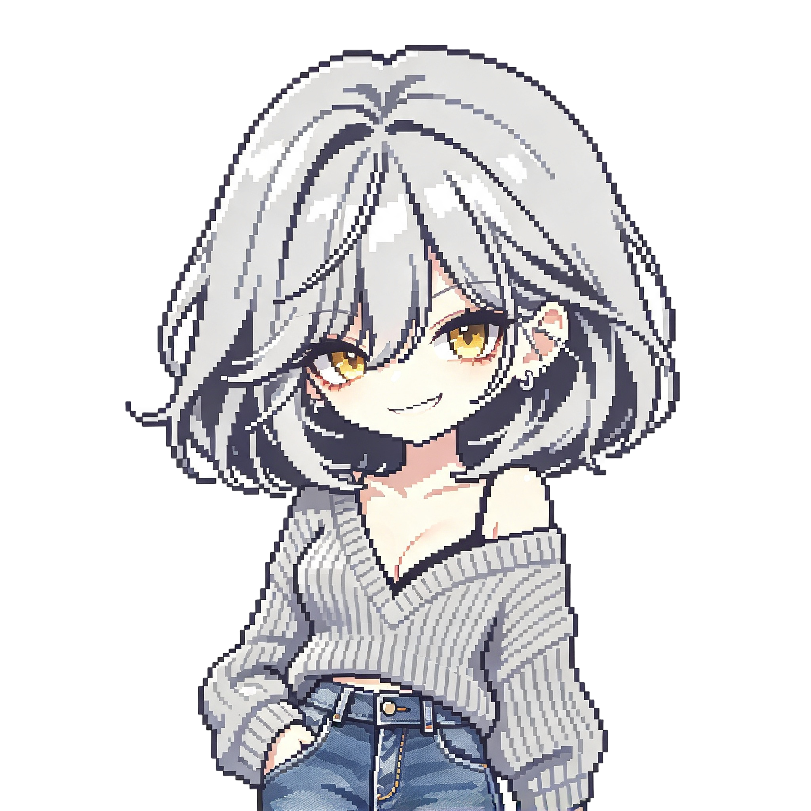

<!-- 言語選択ナビゲーション -->

  

    <b>Language:</b>
    <a href="./README.md">English (main)</a> |
    <a href="./docs/README.ja.md">日本語</a> |
    <a href="./docs/README.ko.md">한국어</a>
  

<!-- ヘッダー画像 -->

  

<!-- ページ間ナビゲーション（上部） -->

  <table>
    <tr>
      <td align="center"><a href="./README.md">Home</a></td>
      <td align="center"><a href="./docs/profile.md">Profile</a></td>
      <td align="center"><a href="./docs/concept.md">Concept</a></td>
      <td align="center"><a href="./docs/services.md">Services</a></td>
      <td align="center"><a href="./docs/portfolio.md">Portfolio</a></td>
      <td align="center"><a href="./docs/contact.md">Contact</a></td>
      <td align="center"><a href="./docs/kazuki.md">Kazuki</a></td>
    </tr>
  </table>

---

## About Me / イントロダクション

はじめまして。ペンネーム **影島 零（カゲシマ レイ）** として活動しています。

現在は学生として学びつつ、来年の新卒就職に向けた準備を進めながら、**20歳までに個人事業主として起業**することを目指して準備を進めています。

当事業 **「zorinix（ゾリニクス）」** は、間に誰も挟まず、私自身が責任を持ってすべての実務を徹底的にやり切る個人事業です。ぶれない一貫性と最高品質のクオリティを追求し、自身の実績・ポートフォリオとして社会に確かな形を遺していきます。

---

## Business Overview / 事業概要（創業準備中）

現在、20歳での個人事業主開業に向けた準備を行っております。

| 項目 | 内容 |
| :--- | :--- |
| **屋号（事業名）** | zorinix（ゾリニクス） |
| **代表者** | 影島 零（カゲシマ レイ）※ペンネーム |
| **事業形態** | 個人事業主（創業準備中 / 20歳起業予定） |
| **事業理念** | 「ITの本当のすがたを教え、一緒に考える仲間になる。」 |
| **主要拠点** | 日本（オンライン全国対応） |

---

## Concept / コンセプト

### 1. 表向きコンセプト（お客さん向け）

> [!NOTE]
> **キャッチコピー：「ITの本当のすがたを教え、一緒に考える仲間になる。」**

高額な専門学校やスクールに行く前に、「ITってなんだろう？」「自分に向いているかな？」「本当にこの仕事をしたいのかな？」を確かめる場所です。
難しい知識がなくても大丈夫です。子どもでも、大人でも、親御さんと一緒でも、同じ目線になって一緒に考えたり、少しずつ勉強しながら、ITの世界の本当のすがたを伝えます。一人で悩んでいる人や、これからITを目指す人の一番身近な「頼れる仲間」になりたいと思っています。
*(※1回ごとのご相談に本気で責任を持つため、有料でお引き受けしています)*

また、他社様からの実務資料の作成や、個人事業主様向けのWebサイト制作、起業のサポートなど、実際の制作や開発の依頼も直接受けています。

### 2. 裏向きコンセプト（自身・zorinix内部向け）

> [!IMPORTANT]
> **内部スローガン：「自分一人で責任を背負いきり、自分の力で生きる形を遺す。」**

* **お金を稼ぎ、生きる目的を見つける**: 自分の腕と力で稼ぎ、誰かに価値を与える側になる。
* **何かを遺す**: 縁を切った元父親や、周囲の起業している知人に自分の成果を見せ、社会に確かな実績を刻む。
* **人と関わる**: 知識がなくて不安な人や子ども・大人の支えとなり、直接誰かの力になることで生きる意味を見出す。

---

## Services / 業務内容

zorinixでは、低レイヤからWeb構築、AI技術、インフラ、進路相談まで幅広く対応します。

1. **OS・低レイヤ・システム開発**
2. **Web開発・フルスタックシステム構築**
3. **多言語テクニカルドキュメント作成**
4. **ネットワーク・インフラ構成**
5. **データ構造・アルゴリズム・自動化処理**
6. **AIプロンプトエンジニアリング・DSL（独自言語）設計**
7. **IT進路・転職の個別リアル相談**（1:1 または 2:1［保護者同伴など］）

---

## Service Delivery Models / サービス提供形態

お客様のご要望・課題に合わせて、柔軟な形態でサポートいたします。

* **1:1 または 2:1 個別オンライン相談**
  * Web会議ツール（Google Meet / Zoom等）を活用した、丁寧な個別対面セッション。お子様＋保護者様でのご相談（2:1）にも完全対応。
* **受託制作・受託開発**
  * Webサイト制作、システム構築、実務資料作成など、要件定義から納品まで影島 零が直接一括で対応。
* **技術顧問・アドバイザリーサポート**
  * 個人事業主様や起業準備中の方へ向けた、IT技術選定や業務自動化の継続的サポート。

---

## Original Character / 日野原 一姫 (ヒノハラ カズキ)

zorinixの世界観を彩るオリジナルキャラクター **日野原 一姫（ヒノハラ カズキ）** です（妄想の彼女という設定です）。
以下に代表的な3つの感情表現のドット絵を掲載しています。その他の豊富なバリエーションや全アセットは [`kazuki.md`](./docs/kazuki.md) をご覧ください。

  <table>
    <tr>
      <td align="center"> Normal</td>
      <td align="center"> Happy</td>
      <td align="center"> Smug</td>
    </tr>
  </table>

---

## Contact / お問い合わせ

ご相談、開発・制作のご依頼、IT進路に関するご質問などは、以下の窓口よりお気軽にご連絡ください。

* **GitHub Issues**: 本リポジトリの [Issues](../../issues) または [Discussions](../../discussions)
* **X (旧Twitter) / SNS**: officialアカウント（準備中）
* **E-mail**: ご相談・ご依頼用フォーム（準備中）

---

<!-- フッター -->
 

<pre>
  ███████╗ ██████╗ ██████╗ ██╗███╗   ██╗██╗██╗  ██╗
  ╚══███╔╝██╔═══██╗██╔══██╗██║████╗  ██║██║╚██╗██╔╝
    ███╔╝ ██║   ██║██████╔╝██║██╔██╗ ██║██║ ╚███╔╝ 
   ███╔╝  ██║   ██║██╔══██╗██║██║╚██╗██║██║ ██╔██╗ 
  ███████╗╚██████╔╝██║  ██║██║██║ ╚████║██║██╔╝ ██╗
  ╚══════╝ ╚══════╝╚═╝  ╚═╝╚═╝╚═╝  ╚═══╝╚═╝╚═╝  ╚═╝
</pre>

<!-- ページ間ナビゲーション（下部） -->
<table>
  <tr>
    <td align="center"><a href="./README.md">Home</a></td>
    <td align="center"><a href="./docs/profile.md">Profile</a></td>
    <td align="center"><a href="./docs/concept.md">Concept</a></td>
    <td align="center"><a href="./docs/services.md">Services</a></td>
    <td align="center"><a href="./docs/portfolio.md">Portfolio</a></td>
    <td align="center"><a href="./docs/contact.md">Contact</a></td>
    <td align="center"><a href="./docs/kazuki.md">Kazuki</a></td>
  </tr>
</table>

 

<b>zorinix / Rei Kagesima (ペンネーム)</b>

<i>「一歩ずつ、確実に。自分の力で生きる形をこの場所に遺す。」</i>

© 2026 zorinix. All rights reserved.

